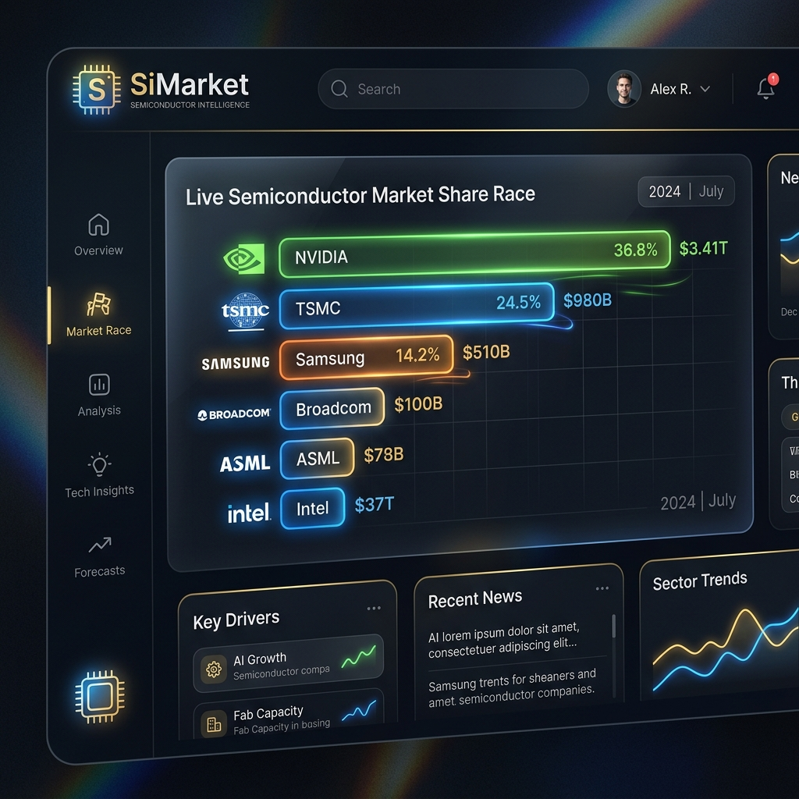

# SiMarket - Global Semiconductor Market Intelligence Dashboard (1970–2026)

🌐 **[한국어 설명 (Korean)](README_KO.md)** | **Live Dashboard:** **[https://eljja.github.io/SiMarket/](https://eljja.github.io/SiMarket/)**

An interactive, high-fidelity data visualization dashboard tracing the historical market size, segment revenues, and vendor shares of the global semiconductor industry from 1970 through the AI-driven computing peak in 2026.



---

## 🚀 Project Overview (What this Repo Did)

This repository hosts a multi-market, dual-language semiconductor market intelligence dashboard. Starting as a basic DRAM tracker, the project has evolved into a comprehensive analytics suite that covers:
* **10 Dashboard Categories**: Traces the market size and vendor shares across 10 distinct sub-sectors:
  1. **Total Semiconductor** (Aggregate dollar revenue model)
  2. **DRAM** (Dynamic Random-Access Memory & HBM3E/HBM4)
  3. **Flash Memory** (NAND & NOR Flash)
  4. **Logic IC** (Microprocessors, GPUs, and custom AI accelerators)
  5. **Analog** (RF, Power Management PMIC, and Op-Amps)
  6. **Opto & CIS** (CMOS Image sensors and optical electronics)
  7. **Power & Discrete** (IGBTs, MOSFETs, and wide-bandgap SiC/GaN devices)
  8. **MCU** (Microcontrollers 8/16/32-bit)
  9. **Foundry** (Pure-play wafer fabrication)
  10. **Fabless** (Design-only semiconductor vendors)
* **Rigorous Data Auditing & Reconciliation**: Restructured the historical timeline database using actual quarterly dollar revenues reported in corporate SEC filings (Samsung, SK Hynix, Micron, NVIDIA, TSMC, Intel, AMD, Qualcomm, Broadcom, TI, ADI, Infineon, STMicro, NXP, Sony, Kioxia, MediaTek), eliminating synthetic share formula anomalies and reconciling individual segment totals with aggregate semiconductor revenues.
* **Dual-Language Parallelization**: Fully localized interactive tooltips, charts, statistics cards, and chronological milestones across both English (`index.html` / `app.js` / `data.js`) and Korean (`index_ko.html` / `app_ko.js` / `data_ko.js`).

---

## 🎯 Core Strategy & Visualization Features

The dashboard is designed to provide actionable business intelligence through a premium user interface:
* **Dynamic Bar Chart Race (ECharts)**: Animates market share rankings over time, allowing users to watch historical corporate rises, acquisitions, and consolidation cycles.
* **Light & Dark Theme Switcher (☀️/🌙)**: Toggle between a sleek glassmorphic dark theme and a high-contrast slate light theme with persistent `localStorage` preference and dynamic ECharts palette adaptation.
* **URL Deep Linking (`#market/period`)**: Direct link sharing for any market tab and period (e.g. `#foundry/2024_Q1`) with native browser Back/Forward navigation support.
* **Timeline Precision Step Controls (`<` / `>`)**: Includes 1-quarter step backward/forward buttons for precise period-by-period industry analysis.
* **Dual-Metric Toggle**: Switches between **Revenue (USD Billions)** and **Byte Capacity Shipped** (specifically for DRAM/Flash memory capacity scaling) or **Wafer Capacity/Device Units** where applicable.
* **Logarithmic Scale Trend Lines**: Displays the exponential scale of silicon shipment volumes spanning 9+ orders of magnitude over 50 years.
* **Minified Database Architecture**: Compact JSON serialization cuts raw database file size from 415KB to 276KB (~55% Gzip compression), accelerating initial page load.
* **Google SEO & Rich Snippets (Schema.org JSON-LD)**: Equipped with `WebApplication` & `Dataset` JSON-LD structured data, OpenGraph social cards, canonical tags, `sitemap.xml`, and `robots.txt` for maximum Google Search indexing visibility.

---

## 📌 Development Status & Completed Milestones

- [x] **10-Category Coverage**: Complete database covering all major silicon categories from 1970 to 2026.
- [x] **Rigorous Mathematics**: Verified that segment sums match the total aggregate dollar market size.
- [x] **Consolidation History**: Accurately maps major M&A events (e.g., Micron acquiring Elpida, AMD spinning off GlobalFoundries, Renesas MCU consolidation, Kioxia rebranding).
- [x] **Quarterly Update Status Badge**: Calculates real-time page load timestamp against build date, displaying `🟢 Up to Date` or `🟡 Update Due (90+ Days)`.
- [x] **Refactored Info Panel**: Dedicated sidebar meta card displaying system intelligence, build date, and dynamic update status.
- [x] **Automated Verification Suite**: Implements a Node.js test suite (`verify_data.js`) for sum-to-100% share compliance and live SHA-256 checksum sync checks.

---

## 🔄 Update & Execution Cycle

The database is designed to be updated on a **quarterly cycle** as semiconductor leaders publish their fiscal reports:

1. **Update generator inputs**: Adjust parameters and quarterly revenue metrics inside `scratch/generate_data.py`.
2. **Compile database**: Run the generator script to compile and format the minified output databases:
   ```bash
   python scratch/generate_data.py
   ```
3. **Verify data integrity**: Execute the automated validation test to verify math and remote sync:
   ```bash
   node scratch/verify_data.js
   ```
4. **Deploy live**: Commit and push changes to `main` branch. GitHub Actions automatically deploys static assets to GitHub Pages within ~1 minute.

---

## 📂 Directory Structure

```
SiMarket/
├── index.html          # Main English dashboard layout (with JSON-LD & SEO)
├── index_ko.html       # Main Korean dashboard layout (with JSON-LD & SEO)
├── style.css           # Premium dark/light glassmorphic stylesheet
├── app.js              # English interactive playback, theme & ECharts logic
├── app_ko.js           # Korean interactive playback, theme & ECharts logic
├── data.js             # Compiled minified English database (1970-2026)
├── data_ko.js          # Compiled minified Korean database (1970-2026)
├── robots.txt          # Search crawler instructions
├── sitemap.xml         # XML sitemap with multilingual hreflang annotations
├── favicon.png         # 3D Microchip Favicon
├── simarket_preview.png # Dashboard visual preview for social cards & README
└── scratch/
    ├── generate_data.py # Automated database compiler script
    └── verify_data.js   # 3-Phase validation test suite
```

---

## 🧪 Database Validation

To ensure no mathematical errors are introduced during updates, run the validation script:
```bash
node scratch/verify_data.js
```
The script performs:
* **Sum-to-100% check**: Validates that all vendor market shares sum to exactly 100% (+/- 0.1% floating-point tolerance).
* **Cross-segment revenue check**: Confirms that DRAM + Flash + Logic + Analog + Opto + Power + MCU revenues match the aggregate total semiconductor revenue.
* **Remote checksum check**: Downloads the remote file from `eljja.github.io` and compares its normalized SHA-256 hash to confirm successful page deployment.

---

## 📄 License

This project is licensed under the **Apache License 2.0** - see the [LICENSE](LICENSE) file for details. Copyright 2026 SiMarket Group.
